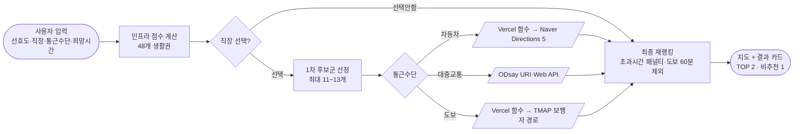

# Cheonan·Asan Lifezone Recommender


천안·아산으로 이주하는 청년이 매물을 보기 전에 자신에게 맞는 생활권을 먼저 고를 수 있도록 돕는 웹서비스입니다.
공공데이터 12건으로 천안·아산 48개 행정동의 교통, 문화·체육, 치안·의료 인프라를 점수화하고, 사용자의 선호도와 통근 조건을 반영해 추천 TOP 2와 비추천 1개를 지도와 결과 카드로 보여줍니다.

제14회 충남 공공데이터·AI활용 창업경진대회에 4인 팀으로 참가한 프로젝트입니다.
저는 외부 경로 API 3종 연동, API 키 보호 구조 설계, 지도·경로 시각화 UI를 맡았습니다. 공공데이터 수집과 전처리는 팀원이 담당했고, 저는 전처리된 데이터를 받아 추천 결과를 지도와 경로 정보로 보여주는 부분을 구현했습니다.

**사용 기술**: JavaScript (ES Modules), Vercel Serverless Functions, Naver Maps API, Naver Directions 5, ODsay, TMAP 보행자 경로

**프로젝트 기간**: 2026.04.06 ~ 2026.05.26

**서비스**: https://alldam-project.vercel.app

---

## 1. Business Question
*"지역을 잘 모르는 사람도 자신에게 맞는 생활권을 한 번에 비교할 수 있을까?"*

새 지역에 정착할 때는 매물 조건 외에도 교통, 생활 인프라, 직장까지의 통근 가능성을 함께 봐야 합니다.
지금은 매물은 부동산 플랫폼에서, 주변 시설은 지도에서, 통근시간은 길찾기 서비스에서 따로 확인해야 합니다.
이 프로젝트는 이 정보를 생활권 단위로 묶어, 사용자의 조건에 맞는 행정동을 추천하는 것을 목표로 했습니다.

## 2. Data Overview

공공데이터포털, 보건의료빅데이터개방시스템, 국토교통부 KRIC 레일포털, 충남 데이터포털 올담의 공공데이터 12건을 사용했습니다. (전처리: 팀원 담당)

| 축 | 사용 데이터 |
| --- | --- |
| 교통 | 버스정류장 위치, 도시철도역사 |
| 문화·체육 | 도서관·작은도서관, 체육 관련 비영리법인 |
| 치안·의료 | 지구대·파출소, 119안전센터, 실내구호소, 안전비상벨, 보안등, 병원, 약국 |

- 주소 기반 데이터는 행정동 단위로, 좌표 기반 데이터는 행정동 경계와 매칭해 48개 생활권(천안 31, 아산 17)으로 집계했습니다.
- 시설 수는 `log1p` 변환 후 48개 행정동 기준 min-max 정규화로 상대 점수화했습니다.
- 원본·전처리 CSV는 저장소에 포함하지 않았습니다. 전처리 결과로 생성한 생활권 데이터(`src/data/generatedLifeZones.js`)와 행정동 경계 데이터만 포함되어 있습니다.

## 3. Architecture



- 경로 API는 48개 전체가 아니라 인프라 점수로 추린 1차 후보군에만 호출합니다.
- 사용자가 고른 통근수단 하나의 API만 호출합니다.
- 비밀 키가 필요한 자동차·도보 API는 Vercel 서버리스 함수가 대신 호출합니다.
- 경로 조회에 실패한 후보는 임의의 시간을 채우지 않고 "정보 없음"으로 표시하며, 점수에도 반영하지 않습니다.

## 저장소 구성

| 경로 | 내용 |
| --- | --- |
| `api/commute/` | Vercel 서버리스 함수 (자동차 Naver Directions 5, 도보 TMAP) |
| `src/components/` | 입력 화면, 결과 카드, 네이버 지도 컴포넌트 |
| `src/utils/` | 추천·통근 점수 계산, 후보군 선정, 각 경로 API 클라이언트, 좌표·경계 처리 |
| `src/data/` | 생활권 데이터, 행정동 경계·중심점, 직장 선택지 |
| `scripts/` | 정적 검증, Vercel 빌드, 생활권 데이터 생성, 경계 데이터 변환, 로컬 서버 |
| `tests/` | Node 기본 테스트 러너 기반 테스트 |
| `docs/` | 점수 산정, 데이터 진단, 실행 방법, API 설정 문서 |

## 4. Tech Stack

**1. 외부 경로 API 연동** (직접 담당)

| 통근수단 | API | 호출 위치 | 키 관리 |
| --- | --- | --- | --- |
| 자동차 | Naver Directions 5 | `api/commute/driving-batch.js` | Client Secret을 Vercel 환경변수에만 저장 |
| 대중교통 | ODsay | `src/utils/odsayTransitApi.js` (브라우저) | URI·Web 키를 등록 도메인으로 제한하고, 빌드 시 환경변수에서 주입 |
| 도보 | TMAP 보행자 경로 | `api/commute/walking-batch.js` | appKey를 Vercel 환경변수에만 저장 |

- 세 API의 응답 형식이 달라 소요시간과 실패 사유를 같은 형태로 정리했습니다.
- 프론트 화면에는 `MISSING_NAVER_ENV`, `TMAP_WALK_RATE_LIMITED` 같은 오류 코드만 표시하고, 키 값은 표시하지 않습니다.

**2. API 키 보호 구조** (직접 담당)

- Naver Client Secret과 TMAP appKey는 서버리스 함수에서만 읽고, 프론트엔드 코드와 `public-config.js`에는 넣지 않았습니다.
- ODsay는 서비스 구조상 브라우저에서 호출하는 URI·Web 키라서 요청에 키가 보입니다. 그래서 키를 소스에 쓰지 않고 Vercel 빌드 때 주입하며, ODsay 콘솔에서 사용 도메인을 제한했습니다.
- `scripts/verify-static-app.mjs`가 빌드 전에 `public-config.js`에 비밀 키 이름이 들어 있지 않은지 검사합니다. `scripts/build-vercel-static.mjs`는 `.env` 파일과 `api/` 폴더가 배포 정적 파일에 섞이지 않도록 막습니다.

**3. 지도·경로 시각화 UI** (직접 담당)

- 네이버 지도 위에 48개 행정동 경계, 추천·비추천 생활권 마커, 직장 마커, 직장과 생활권 연결선을 표시했습니다.
- 결과 카드에 통근수단별 실제 소요시간, 환승 정보, 네이버 길찾기 링크를 함께 보여줍니다.
- 직장을 "선택안함"으로 두면 연결선 없이 인프라 점수만으로 추천합니다.

**4. 추천 점수** (팀 공동 설계)

```
최종 점수 = 인프라 점수 × 인프라 비중 + 통근 적합도 × 통근 비중 − 초과시간 패널티
```

- 인프라 기본 비중은 교통 35%, 문화·체육 35%, 치안·의료 30%이며, 사용자 중요도(낮음·보통·높음)에 따라 조정됩니다.
- 통근 비중은 통근 중요도에 따라 10~30%로 반영됩니다.
- 도보 60분을 넘는 후보는 TOP 추천에서 제외합니다.

## 5. Trade-off 판단 기록

| 상황 | 대안 | 선택 기준 | 결정 | 결과 |
| --- | --- | --- | --- | --- |
| 48개 행정동 × 3개 수단을 모두 조회하면 요청 한 번에 최대 144회 호출 | 전체 조회 / 거리 기반 추정 / 후보군만 조회 | 무료 한도 유지, 실제 경로 기반 추천 유지 | 인프라 점수로 1차 후보군을 추리고, 선택한 수단만 조회 | 요청당 자동차 최대 11회, 대중교통 13회, 도보 11회로 제한 |
| 브라우저에서 API를 직접 호출하면 키가 노출됨 | 프론트 직접 호출 / 서버리스 프록시 | 비밀 키 노출 여부 | Secret이 필요한 Naver·TMAP은 서버리스 함수로 호출 | 비밀 키가 프론트엔드에 노출되지 않는 구조로 배포 |
| 경로 조회 실패 시 표시할 값 | 직선거리 기반 추정 시간 / 실패 표시 | 추천 근거의 정확성 | 임의 시간을 만들지 않고 "정보 없음" 표시 | 실제 경로 결과만 점수에 반영 |

## 6. Execution Guide

### 필요 환경
- Node.js 22 이상 (별도 npm 패키지 설치 없음)

### 로컬 실행

```bash
node scripts/dev-server.mjs
# http://localhost:4173
```

로컬 서버는 정적 파일만 서빙하므로 서버리스 함수가 필요한 자동차·도보 경로는 동작하지 않습니다. 네이버 지도 Client ID는 등록 도메인 기준으로 제한되어 있어, 로컬에서 지도를 보려면 네이버 콘솔에 `http://localhost:4173`을 등록해야 합니다.

### 테스트

```bash
node --test tests/*.test.mjs
node scripts/verify-static-app.mjs
```

### 배포 환경변수 (Vercel)
변수 이름은 [.env.example](.env.example)에 정리되어 있으며, 실제 값은 저장소에 포함하지 않습니다.

| 변수 | 사용처 |
| --- | --- |
| `NAVER_MAP_CLIENT_ID`, `NAVER_MAP_CLIENT_SECRET` | 자동차 경로 서버리스 함수 |
| `TMAP_PEDESTRIAN_APP_KEY` | 도보 경로 서버리스 함수 |
| `PUBLIC_ODSAY_URI_API_KEY` | 빌드 시 `public-config.js`에 주입 |

자세한 설정은 [docs/vercel-directions-setup.md](docs/vercel-directions-setup.md)와 [docs/run-and-share.md](docs/run-and-share.md)에 있습니다.

## 7. Troubleshooting (STAR)

**서로 다른 경로 API 3종의 서버 연동 오류**

Situation (상황): 로컬에서는 코드가 정상인데 배포 환경에서 경로 조회가 계속 실패했습니다. 세 API의 제공처가 달라 콘솔 설정 방식과 키 이름이 모두 달랐습니다.

Task (과제): 실패 원인이 API 설정, 환경변수, 코드 중 어디에 있는지 구분해야 했습니다.

Action (행동): 실패 원인을 오류 코드로 나눠 화면에 표시하게 한 뒤, 세 단계로 확인했습니다.
1. 각 API 제공 사이트에서 서비스 선택, 등록 도메인, 키 이름 오타 확인
2. Vercel 환경변수 등록 여부와 등록 후 재배포 여부 확인
3. 실제 요청을 보내 서버리스 함수의 응답 확인

Result (결과): 세 API 모두 배포 환경에서 정상 호출되도록 맞췄고, 현재도 무료 한도 안에서 운영 중입니다.

## 한계

- 인프라 점수는 시설 개수 기반이라 시설의 규모나 품질은 반영하지 못합니다.
- 임대료, 유동인구, 상권 데이터는 아직 반영하지 않았습니다.
- ODsay는 브라우저 호출 방식이라 키 자체는 요청에서 보이며, 도메인 제한에 의존합니다.

## 개선이 필요한 부분

프로젝트를 다시 검토하면서 확인한 개선점입니다. 코드는 대회 제출 당시 상태로 유지하고 있습니다.

- **서버 함수의 호출 개수 제한**: 수단별 최대 11~13회 호출 제한은 현재 화면 코드에서만 적용됩니다. `api/commute/driving-batch`와 `api/commute/walking-batch`는 요청에 담긴 도착지 수만큼 외부 API를 호출하므로, 누군가 이 주소로 직접 요청을 보내면 무료 한도를 소진시킬 수 있습니다. 서버 함수에서도 도착지 수를 제한해야 합니다.
- **요청 빈도 제한과 출처 확인**: 같은 이유로 IP별 요청 빈도 제한이나 `Origin` 헤더 확인을 추가하면 서비스 외부에서의 호출을 줄일 수 있습니다.
- **좌표 범위 검증**: 서버 함수는 좌표가 지구 범위(위도 ±90, 경도 ±180) 안인지만 확인합니다. 천안·아산 주변 범위로 좁히면 서비스와 무관한 경로 조회를 막을 수 있습니다.

자세한 점수 산정과 데이터 진단 내용은 [docs/core-features.md](docs/core-features.md), [docs/data-scoring-plan.md](docs/data-scoring-plan.md), [docs/preprocessed-csv-diagnosis.md](docs/preprocessed-csv-diagnosis.md)에 정리했습니다.
